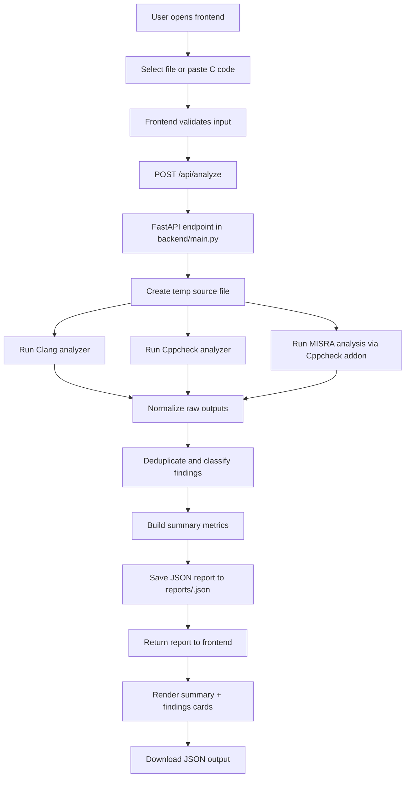

# C Code Analyzer - README V1

## Project Overview

This project is a local C static-analysis workspace that combines multiple analysis tools to scan C source files and produce a unified JSON report. The system is designed to help developers catch safety, correctness, and compliance issues in C before code reaches production.

The project brings together:

- Clang static analysis
- Cppcheck static analysis
- Cppcheck MISRA C:2012 addon checks
- A FastAPI backend for request processing
- A browser-based frontend for uploading files or pasting C code
- Structured result aggregation and deduplication

At a high level, the application accepts a `.c` source file or pasted C code, runs three analyzers, normalizes the output into a common issue model, and returns a consolidated report with summary metrics and issue details.

---

## What the Project Does

This project is not a compiler or a build system. It is a security and quality analysis pipeline for C code. It focuses on:

- detecting memory safety issues
- finding undefined behavior and uninitialized values
- identifying arithmetic problems like division by zero
- surfacing code quality issues and style findings
- checking MISRA C:2012 compliance signals
- packaging results into a clean, downloadable JSON report

The built-in examples under `test_cases/` are intentionally designed to trigger common C defects, including:

- uninitialized variables
- null pointer dereferences
- array out-of-bounds access
- division by zero
- memory leaks and invalid memory management
- MISRA rule violations

---

## Architecture Summary

The project follows a simple layered architecture:

1. Frontend layer
   - `frontend/index.html`
   - `frontend/app.js`
   - `frontend/styles.css`
   - Present the UI and handle file upload or pasted code analysis.

2. API layer
   - `backend/main.py`
   - Exposes the API routes and orchestrates the analysis flow.
   - Validates inputs, creates temporary files, runs analyzers, saves reports, and serves static frontend files.

3. Tool execution layer
   - `backend/clang_analyzer.py`
   - `backend/cppcheck_analyzer.py`
   - Executes external analyzers using subprocess calls.

4. Normalization and deduplication layer
   - `backend/result_processor.py`
   - Parses raw outputs, maps findings to categories, merges repeated results, and builds the final JSON structure.

5. Configuration layer
   - `config/settings.json`
   - `backend/config.py`
   - Controls tool paths, arguments, classification rules, file-size limits, API routes, and report settings.

6. Reporting layer
   - `reports/`
   - Stores generated analysis results as JSON files.

---

## End-to-End Flow



---

## Detailed Runtime Flow

### 1. Frontend input collection

The browser UI in `frontend/` allows users to either:

- upload a `.c` file
- or paste source code directly into a textarea

The frontend fetches config from `/api/ui-config` and checks the backend health endpoint before enabling analysis.

### 2. API validation and upload handling

The `analyze_uploaded_file` route in `backend/main.py` is the main entry point.

It performs the following:

- ensures exactly one input method is provided
- validates file extension (`.c` only)
- validates file size against configuration limits
- reads the uploaded file in chunks or accepts pasted input
- stores the content in a temporary directory
- invokes the analysis pipeline

### 3. Tool-level execution

The project launches three analyses on the same source file:

#### Clang

`backend/clang_analyzer.py`

- executes `clang --analyze`
- captures stdout and stderr
- returns a result dictionary with return code and diagnostic text
- handles timeout and executable-unavailable errors

#### Cppcheck

`backend/cppcheck_analyzer.py`

- executes `cppcheck --xml --xml-version=2 ...`
- parses XML output from stderr
- turns each issue into a normalized finding object
- tracks metadata such as issue ID, severity, file, line, and CWE

#### MISRA via Cppcheck addon

`backend/cppcheck_analyzer.py`

- executes `cppcheck --addon=misra.py ...`
- captures raw output from the addon
- extracts MISRA C:2012 violations using a regex based on the rule format
- emits rule IDs such as `MISRA-C:2012-2.7`

### 4. Result processing and classification

`backend/result_processor.py` is responsible for converting raw tool output into a common internal representation.

It does the following:

- parses Clang warnings/errors
- parses Cppcheck XML findings
- parses MISRA addon output
- classifies issues using rules declared in `config/settings.json`
- merges duplicates that represent the same root problem across tools
- tracks `detected_by`, `messages`, and `tool_diagnostics`
- calculates summary counters

Examples of issue categories used by the project include:

- Memory Safety
- Arithmetic
- Initialization
- Undefined Behaviour
- Code Quality
- MISRA Compliance
- General

### 5. Report generation

The final report is assembled by `build_analysis_report(...)` in `backend/result_processor.py`.

It produces a JSON payload like this:

- `schema_version`
- `file_name`
- `analysis_status`
- `tools_used`
- `summary`
- `tool_errors`
- `findings`

Each finding can include:

- file name
- line and column
- category
- issue type
- severity
- message
- analysis type
- source tool(s)
- unique finding ID
- tool-level diagnostic evidence
- MISRA rule mapping when applicable

### 6. Persistence and retrieval

Each successful analysis is saved under the `reports/` directory using a generated UUID-based filename.

The API exposes:

- `GET /health`
- `GET /api/ui-config`
- `POST /api/analyze`
- `GET /api/reports/{report_id}/download`

The download endpoint streams the generated JSON report back to the user.

---

## Project Structure

```text
c-code-analysis-agent/
├── backend/
│   ├── clang_analyzer.py
│   ├── config.py
│   ├── cppcheck_analyzer.py
│   ├── main.py
│   ├── result_processor.py
│   ├── schemas.py
│   ├── *.pre_config / *.backup files
│   └── ...
├── config/
│   └── settings.json
├── frontend/
│   ├── app.js
│   ├── index.html
│   └── styles.css
├── reports/
│   ├── demo outputs
│   └── generated JSON reports
├── test_cases/
│   ├── demo_01_uninitialized.c
│   ├── demo_02_memory_safety.c
│   ├── demo_03_arithmetic.c
│   ├── demo_04_memory_management.c
│   ├── demo_05_misra.c
│   └── README.md
├── uploads/
│   └── tmp/
├── requirements.txt
├── test_clang.py
├── test_cppcheck.py
├── test_pipeline.py
├── READMEV1.md
└── ...
```

---

## Configuration Model

The project relies heavily on `config/settings.json`.

This file controls:

- allowed input extensions (`.c`)
- executable names (`clang`, `cppcheck`)
- analyzer arguments
- timeout settings
- output/report directory
- classification rules
- upload size limits
- API route names
- frontend static directory path

This design keeps the toolchain flexible and makes it easy to tweak rules without modifying the execution code itself.

---

## How Findings Are Merged and Normalized

The project intentionally reduces noise from multiple tools reporting the same issue.

`merge_findings()` in `result_processor.py` groups findings by:

- file name
- line number
- issue type or MISRA rule

It then merges:

- tool names
- message strings
- diagnostic evidence
- severity ranking

This means one root issue can be displayed as a single merged card even when Clang and Cppcheck both report it.

This is a useful design for C analysis because the same issue often appears across multiple tools with slightly different messages and severities.

---

## Example Interpretation of Results

The sample report in `reports/analysis_result.json` shows the project generating a structured summary like this:

- total findings
- programming defects
- code quality findings
- MISRA violations
- unique MISRA rules

A typical result may include findings such as:

- uninitialized variable access
- division by zero
- null pointer dereference
- array out-of-bounds access
- MISRA rule violations

The frontend then renders these as cards with:

- severity markers
- issue title
- message text
- file and line reference
- tool badges
- expanded detailed evidence via `<details>` blocks

---

## Data and Reporting Model

The JSON report is designed for both automation and human review.

Core report elements:

- `schema_version`: version of the report contract
- `file_name`: original source file name
- `analysis_status`: completed or completed_with_errors
- `tools_used`: names of active analysis tools
- `summary`: aggregated counts
- `tool_errors`: analyzer execution failures
- `findings`: detailed single issue records

This makes the project usable not only as a frontend app but also as a backend service that can feed CI pipelines, dashboards, or downstream reporting systems.

---

## Local Usage

### Prerequisites

Install dependencies:

```bash
pip install -r requirements.txt
```

Make sure these tools are available in the environment:

- `clang`
- `cppcheck`

If the MISRA addon is required, `cppcheck` must include the MISRA script available for its addon path configuration.

### Run the API server

```bash
python -m uvicorn backend.main:app --host 0.0.0.0 --port 8000 --reload
```

Then open:

- `http://localhost:8000/`
- Swagger docs: `http://localhost:8000/docs`

### Run the CLI pipeline directly

```bash
python test_pipeline.py test_cases/demo_01_uninitialized.c
```

This writes a JSON file to the configured reports directory.

---

## Strengths of the Project

- Multi-tool static analysis in one workflow
- Unified issue reporting across different analyzers
- Easy-to-follow UI for manual testing
- Structured JSON output
- Deduplication reduces repeated findings
- Config-driven tuning for tools and categories
- Good fit for C security and compliance scanning

---

## Current Project Scope and Limitations

This project is well suited for:

- educational C static analysis demos
- local developer validation
- compliance-oriented manual review workflows
- security/safety checks on small to medium C codebases

It is less suited for:

- full enterprise-scale code scanning
- deep integration with CI/CD pipelines without further hardening
- production-grade MISRA certification workflows without additional validation and tool configuration

The toolchain also depends on the availability and version compatibility of the underlying external tools (`clang`, `cppcheck`, addon script behavior), which can vary by environment.

---

## Conclusion

This project is a compact but practical C static-analysis platform that combines industry tools with a clean integration layer. It demonstrates how raw analyzer output can be normalized, classified, deduplicated, and presented in a consistent report that helps developers understand risk in C code.

The design is particularly strong in its separation of concerns:

- the frontend handles user interaction
- the backend orchestrates the process
- the analyzers provide raw signal
- the result processor turns that signal into actionable findings

That architecture is the logical foundation for any future extension, such as richer rule tuning, CI integration, historical reporting, or a more advanced dashboard.
